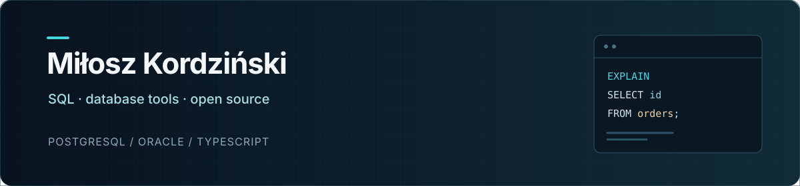
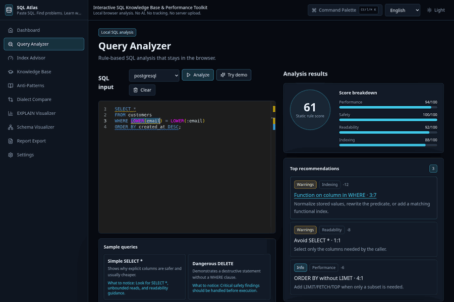

  

  <strong>English</strong> · <a href="./README.pl.md">Polski</a> 
  <a href="https://milekv.github.io/">Portfolio</a> ·
  <a href="https://www.linkedin.com/in/milosz-kordzinski-a85947254">LinkedIn</a> ·
  <a href="https://github.com/milekv?tab=repositories">Repositories</a>

Most days I work on SQL reports and data checks for university systems. Here I build tools for the parts of database work that are easy to miss in review: query structure, execution plans and migration risks. I mostly use PostgreSQL, Oracle and TypeScript.

### What I'm building

**[SQL Atlas](https://github.com/milekv/sql-atlas)** — inspect SQL in the [browser](https://milekv.github.io/sql-atlas/), VS Code, CLI or CI. It points to findings in the source and imports PostgreSQL, SQL Server and Oracle execution plans for review. The analysis runs locally; it does not execute your SQL.

Real browser screenshots from the SQL Atlas repository. [Try the app](https://milekv.github.io/sql-atlas/) · [Read the documentation](https://github.com/milekv/sql-atlas#readme)

**[pg-migration-guard](https://github.com/milekv/pg-migration-guard)** — a preflight check for PostgreSQL migration files. It reports selected locking, rewrite and data-loss risks before deployment; optional database context reads catalog metadata without running migrations. I [tested it on 760 migration files](https://dev.to/milekv/i-tested-a-postgresql-migration-checker-on-760-real-migration-files-4d9h) and documented what those findings do and don't mean.

### Other projects

| Project | What you can inspect |
| --- | --- |
| [Ask Database](https://github.com/milekv/ask-database) | PostgreSQL schema context, relationship-aware text-to-SQL and query validation. [Demo](https://milekv.github.io/ask-database/) |
| [VisualDB Studio](https://github.com/milekv/visualdb-studio) | Visual PostgreSQL schema modelling, relationships, validation and DDL generation. [Demo](https://milekv.github.io/visualdb-studio/) |
| [OraBank](https://github.com/milekv/oracle-bank-system) | Oracle SQL/PLSQL transactions, locking, audit and recovery scenarios. [Walkthrough](https://milekv.github.io/orabank-site/) |

### In open source

I contributed [SQL Server support](https://github.com/Truta446/nplusone/pull/29) and a [libSQL/Turso adapter](https://github.com/Truta446/nplusone/pull/13) to **nplusone**. Both were merged upstream with tests.

My daily tools include PostgreSQL, Oracle, SQL Server, TypeScript, React, Node.js and GitHub Actions. I'm working toward data and cloud engineering, with a particular interest in query plans and measured performance.
