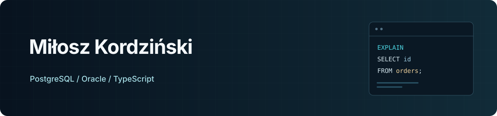

  

  <a href="./README.md">English</a> · <strong>Polski</strong> 
  <a href="https://milekv.github.io/">Portfolio</a> ·
  <a href="https://www.linkedin.com/in/milosz-kordzinski-a85947254">LinkedIn</a> ·
  <a href="https://github.com/milekv?tab=repositories">Repozytoria</a>

Tworzę narzędzia bazodanowe w TypeScripcie. Obecnie rozwijam SQL Atlas i pg-migration-guard.

### Nad czym pracuję

**[SQL Atlas](https://github.com/milekv/sql-atlas)**: Sprawdzaj SQL w [przeglądarce](https://milekv.github.io/sql-atlas/), VS Code, terminalu i CI. Narzędzie wskazuje znalezione problemy w kodzie i pozwala przeglądać plany wykonania PostgreSQL, SQL Server oraz Oracle. Analiza działa lokalnie i nie uruchamia zapytań.

Rzeczywiste zrzuty aplikacji z repozytorium SQL Atlas. [Wypróbuj](https://milekv.github.io/sql-atlas/) · [Przeczytaj dokumentację](https://github.com/milekv/sql-atlas/blob/main/README.pl.md)

**[pg-migration-guard](https://github.com/milekv/pg-migration-guard)**: Sprawdzaj pliki migracji PostgreSQL przed wdrożeniem pod kątem wybranych ryzyk związanych z blokadami, przepisywaniem tabel i utratą danych. Opcjonalnie narzędzie odczytuje metadane katalogu bazy, bez wykonywania migracji. [Sprawdziłem je na 760 plikach migracji](https://dev.to/milekv/i-tested-a-postgresql-migration-checker-on-760-real-migration-files-4d9h) i opisałem, czego można się dowiedzieć z wyników, a czego nie.

### Pozostałe projekty

| Projekt | Co można sprawdzić |
| --- | --- |
| [Ask Database](https://github.com/milekv/ask-database) | Kontekst schematu PostgreSQL, tworzenie SQL z uwzględnieniem relacji i walidacja zapytań. [Demo](https://milekv.github.io/ask-database/) |
| [VisualDB Studio](https://github.com/milekv/visualdb-studio) | Wizualne modelowanie schematu PostgreSQL, relacje, walidacja i generowanie DDL. [Demo](https://milekv.github.io/visualdb-studio/) |
| [OraBank](https://github.com/milekv/oracle-bank-system) | Transakcje Oracle SQL/PLSQL, blokady, audyt i scenariusze odtwarzania. [Opis techniczny](https://milekv.github.io/orabank-site/) |

### Wkład w inne projekty

Do projektu **nplusone** dodałem obsługę [SQL Server](https://github.com/Truta446/nplusone/pull/29) oraz adapter [libSQL/Turso](https://github.com/Truta446/nplusone/pull/13). Obie zmiany, wraz z testami, zostały scalone przez autorów projektu.

Pracuję też nad [obsługą Compose Pull w VS Code Containers](https://github.com/microsoft/vscode-containers/pull/592). Ten pull request jest otwarty i czeka na dalszy przegląd.
